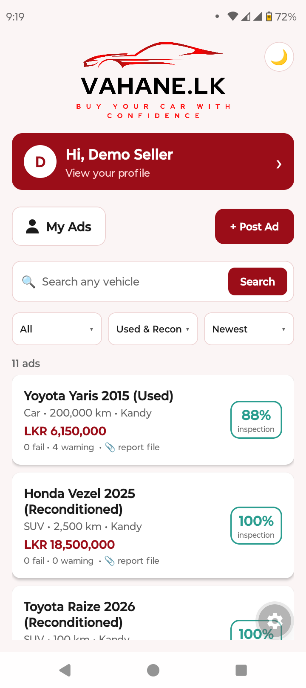
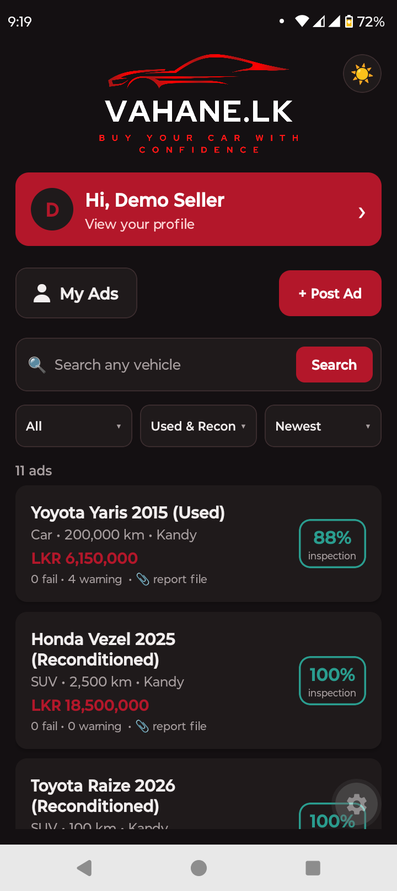
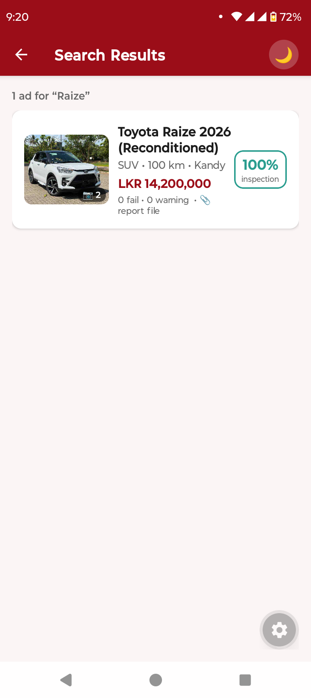
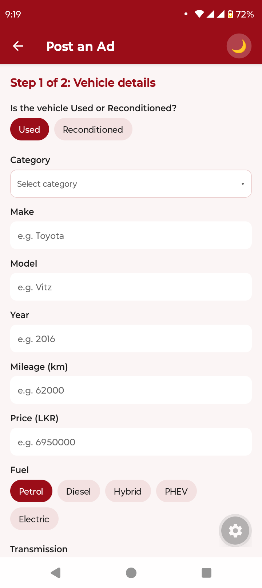
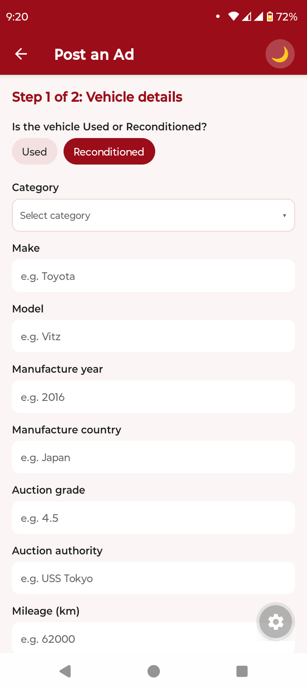
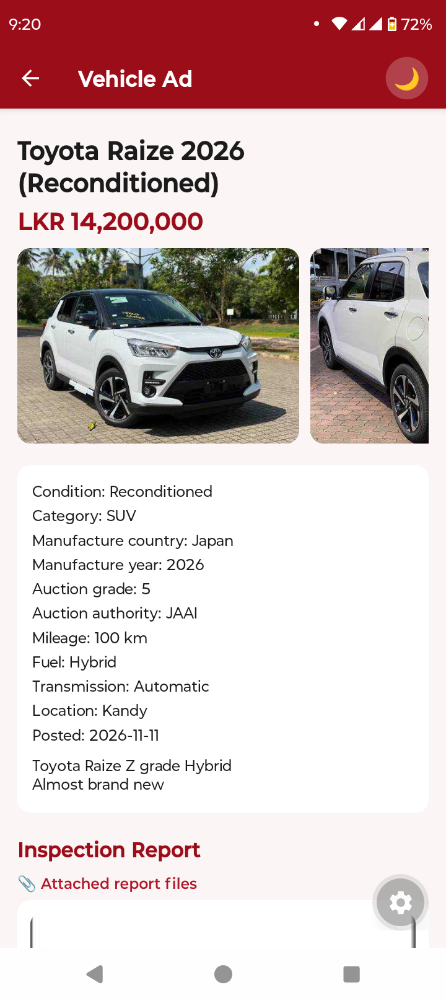
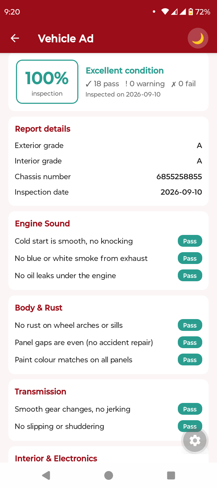
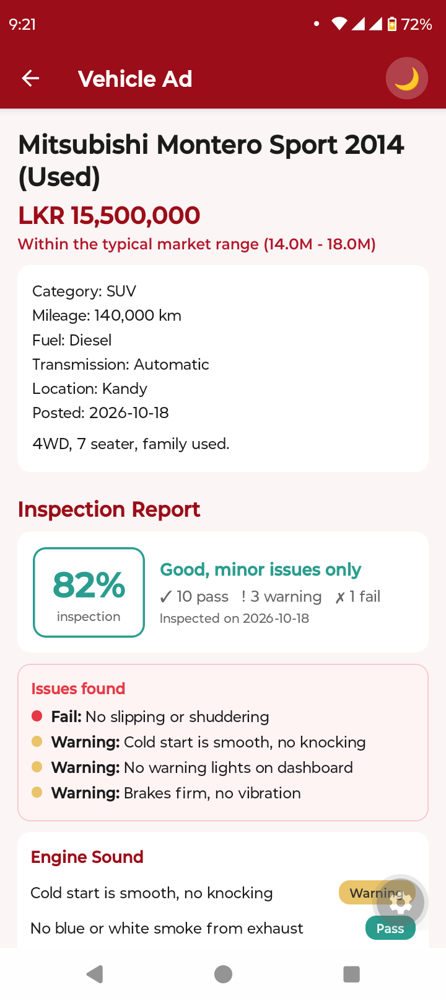
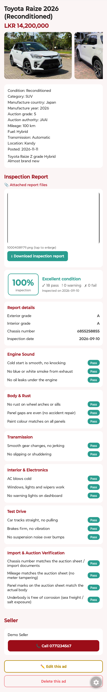
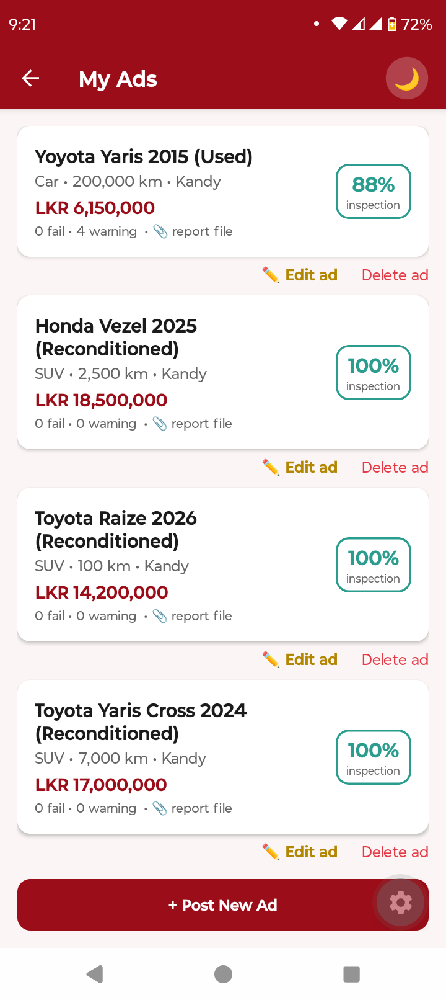

<p align="center">
  
</p>

<h1 align="center">VAHANE.LK</h1>
<p align="center"><b>Buy your car with confidence - Every ad comes with an inspection report.</b></p>

---

## Table of contents

1. [About the project](#1-about-the-project)
2. [Key features](#2-key-features)
3. [Screenshots](#3-screenshots)
4. [Tech stack](#4-tech-stack)
5. [Project structure](#5-project-structure)
6. [How to run the app](#6-how-to-run-the-app)
7. [Demo accounts](#7-demo-accounts)
8. [How the app works](#8-how-the-app-works)
9. [Troubleshooting](#9-troubleshooting)
10. [Limitations and future work](#10-limitations-and-future-work)
11. [License](#11-license)

---

## 1. About the project

Existing Sri Lankan vehicle sites (riyasewana.com, ikman.lk) list vehicles, but they give buyers **no standard inspection report**. A buyer has to trust the seller's words or pay for a separate inspection after finding a car.

**Vahane.lk** makes the inspection report the core of every ad:

- A seller cannot publish an ad without attaching an inspection report and completing a standard checklist.
- Buyers see a clear **score, verdict, issues found and every checked item** on each ad.
- Ads are clearly marked **Used** or **Reconditioned**, and each type has its own inspection details.
- The app also shows typical market prices and common faults for popular models, so buyers can judge a price before they call the seller.

The app is a cross-platform mobile app (Android, iOS and web) built with React Native and Expo. It runs **fully offline**: there is no backend server and no external API. All data is stored on the device.

---

## 2. Key features

**For buyers**
- Browse all ads without logging in.
- Search any vehicle with the **Search** button. Results open on a separate page, with a vehicle photo on the left of every card.
- Filter by **vehicle type** (All, Car, SUV, Van, Lorry, Motorcycle, Threewheel, Pickup) and **condition** (Used / Reconditioned).
- Sort by **Newest**, **Price: Low to High**, **Price: High to Low** or **Best inspection**.
- Ad detail page with a swipeable photo gallery (tap a photo to view it full screen), full vehicle details, market price comparison and common faults for the model.
- Full **inspection report** on every ad: overall score, verdict, issues found, every checked item, inspector notes and report details.
- **Download** the attached inspection report file (photo or PDF).
- Call the seller directly from the ad.

**For sellers**
- Register and log in (stored locally on the device).
- **Post Ad** in two steps:
  1. Vehicle details. The first question is **Used or Reconditioned**.
     - Used: category, make, model, year, mileage, price, fuel (Petrol, Diesel, Hybrid, PHEV, Electric), transmission (Automatic / Manual), district (all 25 districts), phone, description (required) and up to **10 photos**.
     - Reconditioned: everything above plus manufacture country, manufacture year, auction grade and auction authority.
  2. **Inspection report (required).** Attach the report file (photo or PDF), fill in the report details and complete the checklist. Both the details and the checklist change with the vehicle type (Used / Reconditioned).
- **Edit** any of your ads later (details, photos, report, checklist).
- **My Ads** page to view, edit and delete your ads.
- Inspection **draft auto-save** while filling the checklist.

**General**
- **Light / Dark mode** button in the top right corner (your choice is remembered).
- Red and black theme that matches the Vahane.lk logo.
- Animated intro page when the app opens.
- **Profile** page where users can edit their name, phone number and password (the username cannot be changed).
- Works offline. No internet connection is needed.

---

## 3. Screenshots

### Home page (light and dark mode)

| Light mode | Dark mode |
|:---:|:---:|
|  |  |

The 🌙 / ☀️ button in the top right corner switches between light and dark mode.

### Search

| Search results with vehicle photos |
|:---:|
|  |

### Post an Ad (Used and Reconditioned)

| Used vehicle | Reconditioned vehicle |
|:---:|:---:|
|  |  |

The first question decides which fields appear. Reconditioned vehicles also ask for the manufacture country, manufacture year, auction grade and auction authority.

### Ad detail and inspection report

| Reconditioned ad | Inspection report | Used ad with issues found |
|:---:|:---:|:---:|
|  |  |  |

Full ad detail page (photos, vehicle details, attached report file with download button, score, report details, checklist, seller and Edit / Delete buttons):

<p align="center">
  
</p>

### My Ads

| My Ads (Edit / Delete each ad) |
|:---:|
|  |

> More screenshots (intro page, inspection form, profile) can be added to `docs/screenshots/` later. See `docs/screenshots/README.md`.

---

## 4. Tech stack

| Area | Technology |
|---|---|
| Language | JavaScript (JSX) |
| Framework | [React Native](https://reactnative.dev/) 0.88 with [React](https://react.dev/) 19 |
| App platform / tooling | [Expo](https://expo.dev/) SDK 58 (Expo Go, Metro bundler) |
| Navigation | [React Navigation](https://reactnavigation.org/) 7 (native stack) |
| Local storage | `@react-native-async-storage/async-storage` (ads, users, session, drafts, theme, attached files) |
| Photos and files | `expo-image-picker` (gallery and camera), `expo-document-picker` (PDF reports) |
| Report download | `expo-file-system` and `expo-sharing` (phone), browser download (web) |
| Layout and safe areas | `react-native-safe-area-context`, `react-native-screens` |
| Web support | `react-native-web`, `@expo/metro-runtime` |
| Styling | React Native `StyleSheet` with a custom light / dark theme (`src/theme.js`) |
| Data | Local JSON datasets (`src/data/`): car models, checklist items, demo ads, demo users |
| Backend | None (fully offline) |

---

## 5. Project structure

```
vahane-lk/
├── App.jsx                     # Navigation, theme provider, intro page (splash) timer
├── index.js                    # App entry point
├── app.json                    # Expo configuration
├── package.json
├── docs/
│   └── screenshots/            # Put your screenshots here
└── src/
    ├── assets/                 # logo.png, logo-dark.png
    ├── components/             # Reusable UI (ListingCard, Dropdown, Logo, PhotoGallery,
    │                           #   AttachmentPicker/Viewer, InspectionReportView, ScoreBadge,
    │                           #   ThemeToggle, Themed text/inputs)
    ├── context/                # AuthContext (login, register, profile), ThemeContext (light/dark)
    ├── data/                   # carModels.json, checklistItems.json, checklistExtras.json,
    │                           #   listings.json (demo ads), users.json (demo users)
    ├── screens/                # Home, SearchResults, ListingDetail, Auth, PostAd,
    │                           #   InspectionForm, MyAds, Profile, PriceGuide, ModelDetail, Splash
    ├── utils/                  # storage, search/filter/sort, report scoring, report fields,
    │                           #   file picking and download, formatting, alerts
    └── theme.js                # Light and dark colour palettes
```

---

## 6. How to run the app

### 6.1 What you need

| Requirement | Notes |
|---|---|
| **Node.js** | Version **20 or 22 (LTS)** is recommended. Very new versions (for example Node 24) can cause file-watcher errors with Expo. Check with `node -v`. |
| **npm** | Comes with Node.js. Check with `npm -v`. |
| **A phone with Expo Go** (optional) | Install **Expo Go** from the Play Store or App Store. The phone and the computer must be on the **same Wi-Fi network**. |
| **Android Studio / Xcode** (optional) | Only if you want to use an emulator or simulator instead of a phone. |

### 6.2 Step by step

1. **Get the project.** Download and unzip it (or clone it), then open a terminal inside the project folder.

   > Keep the project on a normal local drive such as `C:\` (Windows). Network or shared drives (for example a `Z:` drive in a virtual machine) can break Expo's file watcher.

2. **Install the dependencies**
   ```bash
   npm install
   ```

3. **Install the Expo modules used for downloading reports.** Run this once. It installs the versions that match your Expo SDK.
   ```bash
   npx expo install expo-file-system expo-sharing
   ```

4. **Start the development server** (the `-c` clears the cache and avoids old files being shown)
   ```bash
   npx expo start -c
   ```

5. **Open the app**

   | Where | How |
   |---|---|
   | **Phone (Expo Go)** | Scan the QR code shown in the terminal. On Android use the Expo Go scanner. On iPhone use the Camera app. |
   | **Web browser** | Press `w` in the terminal, or run `npx expo start --web`. It opens at `http://localhost:8081`. |
   | **Android emulator** | Start an emulator in Android Studio, then press `a` in the terminal. |
   | **iOS simulator** (macOS only) | Press `i` in the terminal. |

6. **Log in** with a demo account from the next section, or register a new account.

### 6.3 Useful commands

| Command | What it does |
|---|---|
| `npx expo start -c` | Start the server and clear the cache |
| `npx expo start --web` | Start directly in the browser |
| `npx expo start --tunnel` | Use a tunnel if the phone cannot reach your computer on the Wi-Fi |
| `npx expo install <package>` | Install a package with the correct version for your Expo SDK |

### 6.4 Resetting the app data

All data is stored on the device, so:

- **Phone:** clear the Expo Go app storage, or uninstall and reinstall Expo Go.
- **Browser:** open the browser developer tools, go to *Application → Storage* and choose *Clear site data* for `localhost:8081`.

The demo ads and demo users are loaded again the next time the app starts with empty storage.

---

## 7. Demo accounts

| Username | Password |
|---|---|
| `demo` | `demo123` |
| `nimal` | `nimal123` |
| `kamala` | `kamala123` |

Browsing ads does not need an account. You only need to log in to post, edit or delete ads.

---

## 8. How the app works

### The inspection checklist

Every ad has a checklist. Each item is marked **Pass**, **Warning** or **Fail**. The score is calculated from the items (Pass = 1 point, Warning = half a point, Fail = 0).

| Section | Applies to | Items |
|---|---|---|
| Engine Sound | Used and Reconditioned | 3 |
| Body & Rust | Used and Reconditioned | 3 |
| Transmission | Used and Reconditioned | 2 |
| Interior & Electronics | Used and Reconditioned | 3 |
| Test Drive | Used and Reconditioned | 3 |
| Documents & History | **Used only** | 3 |
| Import & Auction Verification | **Reconditioned only** | 4 |

So a Used ad has 17 checklist items and a Reconditioned ad has 18.

### Report details (typed by the seller)

| Used | Reconditioned |
|---|---|
| Mileage, Inspected by, Inspection date, Chassis number, Registration number (optional) | Mileage, Manufacture year, Manufacture country, Auction grade, Auction authority, Exterior grade (optional), Interior grade (optional), Chassis number, Inspection date |

An inspection report file (photo or PDF) must be attached before an ad can be published or saved.

### Where the data is stored

Everything is saved locally with AsyncStorage:

| Key | Content |
|---|---|
| `vahane_listings` | All ads |
| `vahane_users` | Registered users |
| `vahane_session` | The logged-in user |
| `vahane_draft` | The inspection form draft |
| `vahane_theme` | Light or dark mode |
| attachment keys | Report files and vehicle photos (stored separately so the ads list stays small) |

---

## 9. Troubleshooting

| Problem | What to try |
|---|---|
| `UNKNOWN: unknown error, watch` when starting Expo | Move the project to a local drive such as `C:\`, then run `npm install` again. Also try Node 22 LTS instead of a very new Node version. |
| `Unable to resolve module expo-file-system` (or `expo-sharing`) | Run `npx expo install expo-file-system expo-sharing`, then `npx expo start -c`. |
| The phone cannot open the app / QR code does not work | Make sure the phone and computer are on the same Wi-Fi, or run `npx expo start --tunnel`. |
| Old logo, colours or screens still showing | Run `npx expo start -c` to clear the cache. |
| Bottom buttons hidden behind the Android navigation bar | Make sure you are using the latest `App.jsx` (it adds bottom spacing to every screen). |
| "Could not save" when posting an ad with many photos | Device or browser storage is full. Use fewer or smaller photos. Browsers have a smaller storage limit than phones. |
| Port 8081 already in use | Close the other Expo or Metro process, or accept the new port when Expo asks. |
| Demo data looks outdated after an update | Clear the app storage (see section 6.4) so the demo data loads again. |

---

## 10. Limitations and future work

- Data is stored only on one device. A real release needs a backend (database, user accounts, image storage) so that ads are shared between users.
- Passwords are stored locally with a simple hash. This is fine for a demo but not secure enough for a real service.
- Inspection report details are typed in by the seller. Reading the report file automatically (OCR) is a possible future feature.
- Ideas: favourites, seller-to-buyer chat, push notifications, Sinhala and Tamil language support, verified inspector accounts.

---

## 11. License

See the [LICENSE](LICENSE) file.
